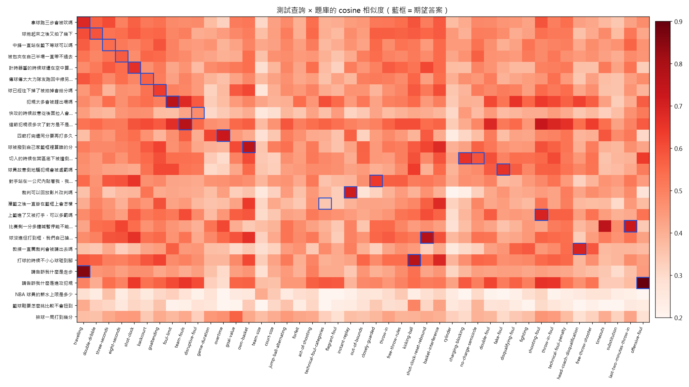

# FIBA 規則 FAQ 查詢

[](https://github.com/kdwjzh/fiba-rules-faq/actions/workflows/ci.yml)
[](https://github.com/kdwjzh/fiba-rules-faq/actions/workflows/pages.yml)

輸入口語問題（例如「拿球跑三步會被吹嗎」），用 embedding 從自建的 45 題 **FIBA Official Basketball Rules 2026** 題庫找出最相關的規則，再用結構化輸出產生附條號的回答。

- 作品頁：https://kdwjzh.github.io/fiba-rules-faq/
- 課程「設計機器學習平台與系統架構」個人作業「AI 小專案上線」

> 規則以 FIBA 官方規則書為準，本工具僅供學習查詢。題庫答案為作者自行整理，非規則書原文。

## 功能

| 指令 | 做什麼 | 用到的能力 |
|---|---|---|
| `faq.build_index` | 把題庫（問題＋別名＋答案）轉成向量，存到 `data/index.npz` | embedding |
| `faq.ask "問題"` | 找出最相關的 3 題與相似度；最高分低於 0.50 就回「題庫沒有相關規則」 | embedding |
| `faq.answer "問題"` | 把 top-3 交給 `qwen3:1.7b`，輸出 `answer`／`source_ids`／`confidence`，再由程式檢查出處只能是 top-3 | 結構化輸出 |
| `faq.report` | 跑 27 條測試查詢，算 Hit@1、Hit@3、拒答正確率，輸出作品頁用的 `results.json` 與熱圖 | embedding（加 `--answers` 再跑結構化輸出） |

模型都跑在本地 Ollama：embedding 用 `qwen3-embedding:0.6b`，回答用 `qwen3:1.7b`，不需要任何雲端金鑰。

## 安裝與執行（Windows PowerShell）

需要先安裝 [uv](https://docs.astral.sh/uv/)、Git、Docker Desktop。

```powershell
git clone https://github.com/kdwjzh/fiba-rules-faq.git
cd fiba-rules-faq
uv sync
Copy-Item .env.example .env

# 啟動 Ollama 並下載模型（模型存在 ollama volume）
docker volume create ollama
docker compose up -d ollama
docker compose exec ollama ollama pull qwen3-embedding:0.6b
docker compose exec ollama ollama pull qwen3:1.7b

# 建索引、查詢
uv run python -m faq.build_index
uv run python -m faq.ask "拿球走三步會怎樣"
uv run python -m faq.answer "請告訴我什麼是進攻犯規"
```

執行範例：

```text
問題：請告訴我什麼是進攻犯規
檢索：offensive-foul 0.900、shooting-foul 0.661、team-fouls 0.651

進攻犯規是控球方球員在比賽中造成個人犯規，如帶球撞防守者或掩護時撞對手，罰球由對方發界外球。
出處：offensive-foul（FIBA OBR 2026 Art. 33、Art. 42）
信心：高
```

### 產生評估結果、跑測試

```powershell
uv run python -m faq.report            # 只跑檢索，約 10 秒
uv run python -m faq.report --answers  # 加跑模型回答，約 7 分鐘
uv run ruff check .
uv run pytest -q                       # 不呼叫模型
```

### 全部在容器裡跑

```powershell
docker compose run --rm app faq.build_index
docker compose run --rm app faq.answer "快攻從後面拉人會怎麼判"
```

`Dockerfile` 是 multi-stage，執行階段以非 root 使用者 `app` 執行；`data/` 掛載回主機，索引不會因為容器刪掉而消失。

## 執行結果

27 條自己設計的口語測試查詢（題庫內 24、題庫外 3）：

| 指標 | 結果 |
|---|---|
| Hit@1 | 17/24（71%） |
| Hit@3 | 22/24（92%） |
| 題庫內誤拒 | 0/24 |
| 題庫外拒答 | 2/3 |
| 模型回答（題庫內） | 採用 19（出處正確 17）、guard 擋下 5 |



每條查詢的檢索結果與模型回答、已知限制，請看[作品頁的「執行結果」](https://kdwjzh.github.io/fiba-rules-faq/#results)。

## 專案結構

```text
faq/
  llm.py          模型設定（本地／雲端切換，改自課程 Lab 5）
  store.py        純函式：載入題庫、cosine、top-k、門檻（不呼叫模型）
  build_index.py  題庫 → embedding → data/index.npz
  ask.py          命令列檢索
  answer.py       結構化回答＋guard
  report.py       評估、輸出 site/data/results.json 與 site/similarity.png
data/
  faq.json           題庫 45 題（全部 verified）
  test_queries.json  測試查詢 27 條
tests/            pytest（題庫格式、store、guard、report），不呼叫模型
site/             GitHub Pages 作品頁
docs/ai-usage-log.md  每個里程碑的 AI 使用紀錄
.github/workflows/    ci.yml（ruff＋pytest）、pages.yml（部署作品頁）
Dockerfile、compose.yaml
```

## AI 使用說明

開發時使用 **Claude Code**（Anthropic，模型 Claude Opus 5.5）輔助：建 repo 與 workflow、寫程式與測試、讀規則書起草題庫。題庫答案一律先標 `draft`，由我對照 FIBA 規則書 PDF 核對後才改成 `verified`。

| 用了什麼工具 | 用在哪裡 | 我自己修改或驗證了什麼 |
|---|---|---|
| Claude Code | 建 repo、`.gitignore`、GitHub Actions | 自己建立 Public repo；push 認證失敗時改用瀏覽器登入授權；Pages 第一次部署失敗，重新設定 Source 並手動 Run workflow 後確認綠燈 |
| Claude Code | 環境（uv、Docker、Ollama） | 選擇用 winget 裝 uv；自己安裝 WSL 2 和 Docker Desktop，照課程環境做 |
| Claude Code | 起草題庫 45 題 | 對照 FIBA 2026 v1.1 規則書逐題核對後才改成 verified；確認 throw-in-foul 原本漏了「最後 2 分鐘」條件 |
| Claude Code | 程式與測試 | 同意拒答改由檢索門檻決定、保留思考模式；自己試問發現「什麼是走步」「什麼是進攻犯規」答不好，回報後請它補定義句、新增進攻犯規題目，修正後重跑都答對 |
| Claude Code | 評估報告、Dockerfile／compose | 決定不做本地 vs 雲端比較表，加分項改靠 Dockerfile／compose 和 CI 跑 pytest |

AI 寫錯而被抓出來的地方（throw-in foul 條件、無衝撞區半徑、技術犯規罰球人選、五犯條號）列在[作品頁](https://kdwjzh.github.io/fiba-rules-faq/#ai)，完整過程在 [docs/ai-usage-log.md](docs/ai-usage-log.md)。

## 參考資料

- [FIBA Official Basketball Rules 2026（v1.1）](https://assets.fiba.basketball/image/upload/documents-corporate-fiba-official-rules-2026-v1-1.pdf)
- [FIBA 2026 規則修改摘要](https://assets.fiba.basketball/image/upload/documents-corporate-fiba-official-rules-2026-rule-changes-v10a.pdf)
- 課程第 4–7 週講義與 Lab 4、Lab 5 範例程式
